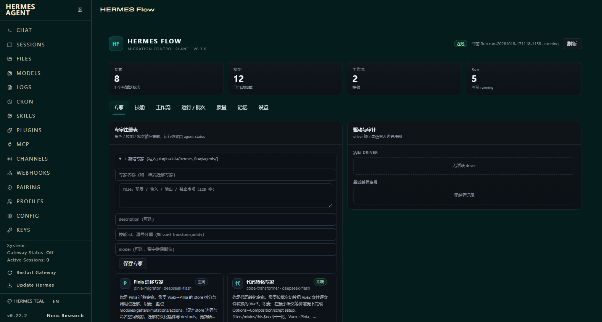
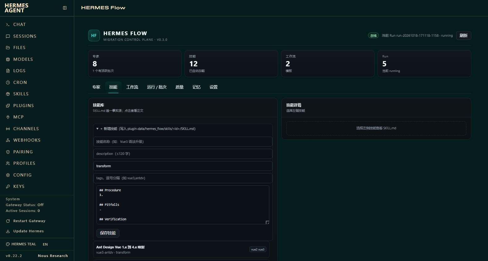
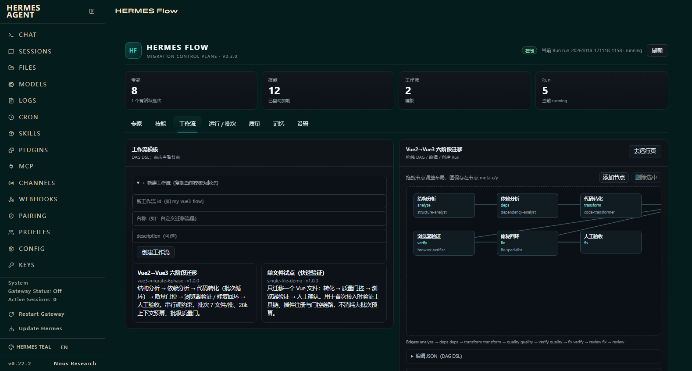

# 自定义专家 / 技能 / 工作流

WebUI 路径：Dashboard → **HERMES Flow** → 顶部 7 Tab。
写入位置：`E:\hermes\plugin-data\hermes_flow\`（可用 `HERMES_HOME` 覆盖）。

## 1. 新增专家

### WebUI

1. 打开 **专家** Tab。
2. 展开「＋ 新增专家」。
3. 填写：
   - **专家名称**：必填，会自动 slug 成 id；
   - **role**：必填，≥20 字，建议写清「职责 / 输入 / 输出 / 禁止事项」；
   - **description**：可选；
   - **技能 id**：逗号分隔，例如 `vue3-transform,antdv`；
   - **model**：可选，留空继承默认。
4. 点 **保存专家**。

写入：`plugin-data/hermes_flow/agents/<id>.json`。  
保存后立即出现在专家卡；可绑定技能、由工作流节点 `agent` 字段引用。



### API / 工具

```bash
POST /api/plugins/hermes_flow/agents
{
  "name": "样式迁移专家",
  "role": "你是 Vue2→Vue3 样式迁移专家，负责 Less/SCSS 变量与主题迁移...（≥20字）",
  "description": "可选",
  "skills": ["vue3-less"],
  "model": "",
  "toolsets": [],
  "loop_policy": {}
}
```

工具：`flow_agent_create`；文件：`agents/<id>.json`。

## 2. 新增技能

### WebUI

1. 打开 **技能** Tab。
2. 展开「＋ 新增技能」。
3. 填写：
   - **技能名称**、**description**（≤120 字）；
   - **phases**：逗号分隔，例如 `transform,quality`；
   - **tags**：逗号分隔；
   - **正文**：必须包含 `## Procedure`、`## Pitfalls`、`## Verification`（校验会检查）。
4. 点 **保存技能**，右侧会直接打开新 SKILL.md。

写入：`plugin-data/hermes_flow/skills/<id>/SKILL.md`。



### API / 工具

```bash
POST /api/plugins/hermes_flow/skills
{
  "name": "UI 验收技能",
  "description": "UI 验收测试，检查渲染与交互（≤120字）",
  "phases": ["verify", "quality"],
  "tags": ["ui", "qa"],
  "body": "## Procedure\n1. ...\n\n## Pitfalls\n- ...\n\n## Verification\n- ..."
}
```

工具：`flow_skill_create`；文件：`skills/<id>/SKILL.md`。

## 3. 自定义工作流

### WebUI

1. 打开 **工作流** Tab，先点一个模板作为起点（如六阶段迁移）。
2. 展开「＋ 新建工作流（复制当前模板为起点）」。
3. 填写新 **id**（如 `my-vue3-flow`）、**名称**、描述 → **创建工作流**。
4. 新工作流会出现在左侧列表；点击后：
   - **拖拽节点**调整布局，位置写入 `node.meta.x/y`；
   - **添加节点** / **删除选中**；
   - **编辑 JSON（DAG DSL）** 修改 agent/skill/batch 参数/边；
   - **保存工作流** 持久化。
5. 到 **运行 / 批次** Tab，选择新工作流 → 填 project_root/files → 创建 Run。



### DSL 关键字段

```json
{
  "id": "my-vue3-flow",
  "name": "自定义迁移流程",
  "version": "1.0.0",
  "nodes": [
    {"id": "analyze", "type": "agent_task", "name": "结构分析",
     "phase": "analyze", "agent": "structure-analyst",
     "skills": ["vue3-analyze"], "meta": {"x": 16, "y": 14}},
    {"id": "transform", "type": "batch", "name": "代码转化",
     "phase": "transform", "agent": "code-transformer",
     "skills": ["vue3-transform"], "batch": {"max_files_per_batch": 7}},
    {"id": "quality", "type": "quality_gate", "name": "质量门",
     "phase": "quality", "agent": "quality-analyst"}
  ],
  "edges": [
    {"source": "analyze", "target": "transform"},
    {"source": "transform", "target": "quality"}
  ]
}
```

- 必须有 `id`、`name`、`nodes`；`edges` 用 `source/target`。
- `batch` 节点必须带 `batch` 配置；`quality_gate` / `human_gate` / `loop` 按类型配置。
- 保存时会做环检测；有环会被拒绝。
- 内置模板在插件 `workflows/`；用户工作流写入 `plugin-data/hermes_flow/workflows/`，同 id 覆盖用户副本。

## 4. 文件 / API 兜底

| 对象 | 文件 | API | 工具 |
|---|---|---|---|
| 专家 | `agents/<id>.json` | `POST /agents` | `flow_agent_create` |
| 技能 | `skills/<id>/SKILL.md` | `POST /skills` | `flow_skill_create` |
| 工作流 | `workflows/<id>.json` | `POST /workflows` | `flow_workflow_create` |

手工改文件后刷新 Dashboard（或重启）即可重新加载。

## 5. 注意

- 专家 role、技能正文、工作流 DAG 都有校验；保存失败时页面顶部显示错误。
- 技能 id 由名称 slug 生成；同名会覆盖/冲突，建议唯一命名。
- 当前 WebUI 支持新增与编辑，技能/工作流删除仍需删文件或调用注册表；专家可删除。
- 拖拽只改布局；连线/节点类型/批量参数通过 JSON 编辑。
