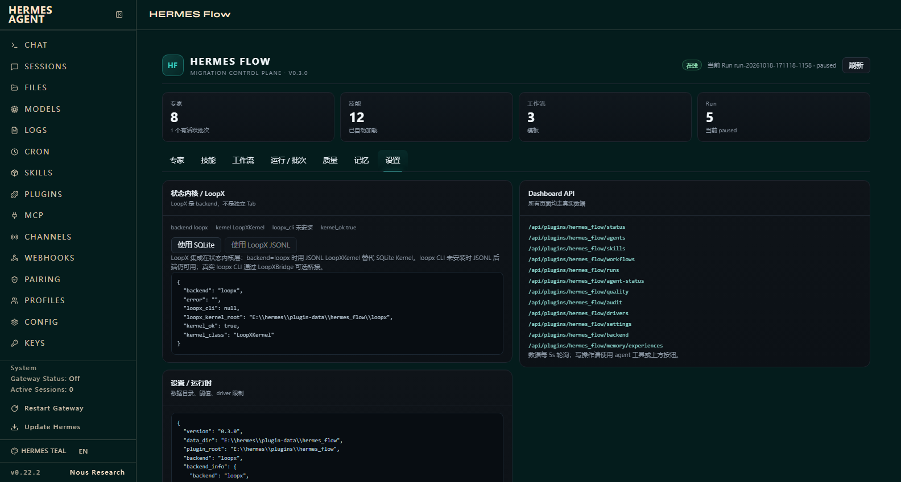

# HERMES Flow 插件使用说明

> 适用版本：仓库 `main`（含 React Flow 可视化工作流、专家/技能新增表单）。
> 发布版：GitHub `v0.3.0` 是上一个稳定 Release；本文命令同样适用，但 v0.3.0 的 Dashboard 工作流编辑器是 JSON/旧画布，没有 React Flow。
> 仓库：https://github.com/cz341003/hermes-flow

---

## 1. 插件是什么

HERMES Flow 是 Hermes Agent 的独立插件，把「Vue2 → Vue3 迁移」做成可编排、可观测、可断点续跑的流水线：

- 8 个内置专家、12 个技能、2 个工作流模板；
- DAG 工作流 + 批次循环；
- 真实子代理批量转换（`flow_batch_auto`）；
- 真实 build / typecheck / Chrome 路由质量门；
- 写入边界审计、越界回滚、人工门；
- Dashboard 7 个 Tab；
- 经验库自动召回/沉淀；
- 可选 LoopX 状态内核。

默认数据目录：

```text
E:\hermes\plugin-data\hermes_flow\
```

---

## 2. 安装

### 2.1 前置条件

| 依赖 | 要求 |
|---|---|
| Hermes Agent | `>= 0.22`（当前 E:\hermes v0.22.2） |
| Python | 3.9+ |
| Windows 子代理 | Git Bash（如 `E:\Git\bin\bash.exe`） |
| 目标项目构建 | Node/npm（Vite/Vue3 项目） |
| 浏览器质量门 | Chrome 或 Edge |
| Dashboard 前端开发 | Node/npm（仅改前端时需要） |

Windows 上建议在 Hermes 的 `.env` 中设置：

```text
HERMES_GIT_BASH_PATH=E:\Git\bin\bash.exe
```

否则子代理可能报 `No shell found`。

### 2.2 从源码安装（推荐，含最新 UI）

```powershell
cd E:\deepSeek
powershell -ExecutionPolicy Bypass -File .\plugin\hermes_flow\install.ps1 `
  -HermesHome E:\hermes -Copy -Enable
```

- 默认建 junction；`-Copy` 复制，跨盘/权限受限时用；
- `-Enable` 会执行 `hermes plugins enable hermes_flow`；
- 安装脚本会先备份已有目录到 `E:\hermes\backups\`。

安装后验证：

```powershell
hermes plugins list --plain --no-bundled
hermes plugins doctor hermes_flow --ci
hermes flow status
hermes flow doctor
```

期望：`34 tools / 1 hook`，doctor 的 `kernel_ok=true`。

然后**重启 Hermes / Dashboard**，打开：

```text
http://127.0.0.1:9119/flow
```

### 2.3 从 Release zip 安装

```powershell
# 1) 下载 hermes_flow-<version>.zip 并解压到插件目录
Expand-Archive .\hermes_flow-0.3.0.zip -DestinationPath $env:HERMES_HOME\plugins\hermes_flow -Force

# 2) 启用
hermes plugins enable hermes_flow

# 3) 验证
hermes plugins doctor hermes_flow --ci
```

v0.3.0 的 zip 已包含 `cli.py` / `dashboard/dist`，可直接安装；但工作流编辑器为旧版。

### 2.4 配置启用

`E:\hermes\config.yaml` 中确认：

```yaml
plugins:
  enabled:
    - hermes_flow
```

修改后重启 Hermes。Dashboard 页签出现在左侧 **HERMES Flow**（路径 `/flow`）。

---

## 3. 第一次使用：10 分钟跑通

### Step 1：打开 Dashboard

- **专家**：查看 8 个专家、技能绑定、运行态；
- **技能**：查看 12 个 SKILL.md；
- **工作流**：选择模板/编辑 DAG；
- **运行 / 批次**：创建 Run、查看批次/文件/事件；
- **质量**：真实 build + 浏览器验证；
- **记忆**：经验搜索/新增；
- **设置**：数据目录、后端、阈值。

### Step 2：新增专家/技能（可选）

- 专家 Tab → 「＋ 新增专家」：名称、role（≥20 字）、skills（逗号分隔）、model；
- 技能 Tab → 「＋ 新增技能」：名称、description、phases、tags、正文（必须含 Procedure/Pitfalls/Verification）。

详见 [USAGE_CUSTOMIZE.md](USAGE_CUSTOMIZE.md)。

### Step 3：创建工作流

- 工作流 Tab → 选模板 → 「＋ 新建工作流（复制当前模板）」→ 填新 id/name → 创建；
- React Flow 画布：拖拽节点、从右侧端口拉到左侧端口连线；
- 工具栏：添加节点 / 删除选中 / 隐藏总览；
- 右侧/下方表单可改 name/phase/agent/skill、增删节点/连线；
- 高级字段（`type`、`batch`、`timeout_s`）用 JSON；
- 点「保存工作流」。

### Step 4：创建 Run

Dashboard → 运行 / 批次 → 填：

- `project_root`：目标 Vue2 项目绝对路径；
- `files`：JSON 数组，如 `[{"path":"src/A.vue","size":129}]`；
- 选择工作流 → 「创建 Run」。

但注意：**Dashboard 的「创建 Run」只创建运行记录和批次组，不会自动调用 LLM 执行**。真正执行需要下一步的 `flow_batch_auto`。

### Step 5：在 Hermes 对话里驱动批次

在 Hermes 会话（或 one-shot）中让 agent 调用工具：

```text
flow_batch_auto(
  group_id="<Run 详情里的批次组 id>",
  max_batches=3,
  max_seconds=180,
  apply=true,
  audit=true,
  concurrency=2,
  quality=false
)
```

- `group_id` 从 Dashboard Run 详情或 `flow_run_status` 获取；
- 每次最多推进 `max_batches` 批 / `max_seconds` 秒；
- 返回 `done / batches_done / batches_total / events`；
- **循环调用直到 `done=true`**；
- 必须在 Hermes agent turn 内调用（有 parent session），不能在纯 Python 脚本/CLI 里直接跑真实子代理。

也可让 agent 用一句话执行：

```text
请对 group g-xxxxxxxx 循环调用 flow_batch_auto，直到 done=true；
每轮 max_batches=3, max_seconds=180, apply=true, audit=true, concurrency=2。
每次返回后报告 batches_done/batches_total 和失败批次。
```

### Step 6：质量门

批次全部完成后，Dashboard → 质量：

- 填项目路径 → 「运行质量采集」；
- 默认异步：返回 job_id，页面轮询；build/typecheck/Chrome 路由结果展示；
- 或直接调用：

```text
flow_quality_gate(
  project_root="E:\\proj",
  batch_scores=[97, 96, 98],
  coverage=1.0,
  browser=true
)
```

### Step 7：审计与人工门

- `flow_batch_auto` 默认 `audit=true`；
- 子代理写批外文件 → 自动回滚、Run `gated`；
- Dashboard Run 页 → 「批准 / 驳回」；
- 越界证据在「驱动与审计」/ `plugin-data/hermes_flow/audit/`。

---

## 4. 任务如何执行（三种方式）

### 4.1 Dashboard + Hermes 对话（推荐，真实迁移）

1. Dashboard 创建/选择 Run；
2. Hermes 对话调用 `flow_batch_auto`（可循环）；
3. Dashboard 实时看批次/事件；
4. 质量页采集；
5. 人工门批准/驳回。

适合真实迁移：子代理有 shell/文件工具，能真正改工作区。

### 4.2 定时/无人值守

Hermes cron 或外部循环每 N 分钟调用一次：

```text
flow_batch_auto(group_id="g-...", max_batches=2, max_seconds=180, apply=true)
```

- 文件锁保证同一 group 同时只有一个 driver；
- 429 自动 requeue（不消耗 attempt）；
- 崩溃后租约过期，下一轮自动重认领；
- `done=true` 后停止。

### 4.3 CLI（不执行真实子代理）

CLI 用于检查/演示/质量验证，不会启动真实 lifecycle 子代理：

```powershell
hermes flow status
hermes flow doctor
hermes flow --backend loopx doctor
hermes flow backend --set loopx
hermes flow backend --set sqlite
hermes flow agents
hermes flow skills
hermes flow workflows
hermes flow demo --files 287 --batch-size 7
hermes flow plan-batch files.json --batch-size 7
hermes flow run vue3-migrate-6phase --files 20 --project-root E:\proj
hermes flow verify E:\proj --browser
hermes flow board --out board.html
```

> `hermes flow run` 使用 mock runner，只验证 DAG/批次编排；真实执行必须用 `flow_batch_auto`。

---

## 5. 核心工具

完整 34 个工具见 README 第 7 节。最常用：

| 工具 | 用途 | 主要参数 |
|---|---|---|
| `flow_run_start` | 创建 Run | `workflow_id`, `project_root`, `files`, `title` |
| `flow_run_status` | 查 Run/列表 | `run_id` |
| `flow_run_pause/resume/cancel` | 控制 Run | `run_id` |
| `flow_batch_plan` | 为节点规划批次 | `run_id`, `node_id`, `files`, `policy` |
| `flow_batch_next` | 手动认领下一批 | `group_id`, `owner` |
| **`flow_batch_auto`** | 自动驱动真实子代理 | `group_id`, `max_batches`, `max_seconds`, `apply`, `audit`, `concurrency`, `quality`, `browser` |
| `flow_batch_status` | 批次组状态 | `group_id` |
| `flow_batch_items` | 批内文件状态 | `batch_id` |
| `flow_batch_ingest` | 手动回灌结果 | `group_id`, `batch_id`, `results` |
| `flow_batch_complete/fail/split/repair` | 手动生命周期 | `batch_id` |
| `flow_quality_collect` | 真实 build/typecheck/Chrome | `project_root`, `browser`, `timeout` |
| `flow_quality_gate` | 聚合质量门 | `project_root`, `batch_scores`, `coverage`, `browser` |
| `flow_agent_create/list/get/update/delete` | 专家 CRUD | `name`, `role`, `skills`… |
| `flow_skill_create/list` | 技能 | `name`, `description`, `body`, `phases`, `tags` |
| `flow_workflow_create/list/get/validate` | 工作流 | `definition` / `workflow_id` |
| `flow_experience_add/search` | 经验库 | `category`, `trigger`, `solution`, `query` |
| `flow_recovery_classify` | 异常分类 | `error`, `status_code` |
| `flow_board_render` | HTML 看板 | `title`, `out` |

### 批次参数建议

| 参数 | 建议 |
|---|---|
| `max_batches` | 2–5；一次调用别太大 |
| `max_seconds` | 180–300；Hermes 工具硬超时 420，driver 硬上限 360 |
| `apply` | 真实迁移 `true`；只生成 staging 时 `false` |
| `audit` | 默认 `true`；不要关闭 |
| `concurrency` | 1（默认）/2/3；3 需要足够子代理并发 |
| `quality` | 批次全部完成后需要自动质量门时 `true` |
| `browser` | `quality=true` 且需要 Chrome 路由验证时 `true` |

---

## 6. Dashboard 各 Tab

| Tab | 能做什么 |
|---|---|
| 专家 | 专家卡、运行态、批次策略；新增/删除专家 |
| 技能 | SKILL.md 列表/正文；新增技能 |
| 工作流 | **React Flow 可视化编辑**、拖拽/连线/增删节点、表单/JSON、新建模板、创建 Run |
| 运行 / 批次 | Run 列表、节点步进、批次/文件明细、事件流、暂停/继续/取消、人工门批准/驳回、节点重跑 |
| 质量 | 异步 build/typecheck/Chrome 采集、路由结果、历史证据 |
| 记忆 | 经验搜索/新增 |
| 设置 | 数据目录、后端、阈值、driver 状态、审计证据、API 索引 |

---

## 7. 数据目录与备份

```text
E:\hermes\plugin-data\hermes_flow\
├── agents/                 # 用户专家 JSON
├── skills/<id>/SKILL.md    # 用户技能
├── workflows/              # 用户工作流
├── runs/<run_id>.json      # Run 快照/事件
├── state.db                # SQLite 状态内核
├── batches.db              # 批次/文件级幂等
├── experience.db           # 经验库
├── staging/<group>/<batch> # 子代理 staging 写回区
├── worktrees/              # 并行批次隔离源
├── backups/                # staging_apply 文件备份
├── audit/                  # 越界审计基线/证据
├── quality/                # build/browser 证据与截图
└── driver-locks/           # driver 单例锁
```

- 升级/重装不会清空数据目录；
- 删插件不会删数据；
- 大规模迁移前建议备份整个 `plugin-data/hermes_flow` 和目标项目；
- 目标项目建议用 git 分支/备份，审计只覆盖批次允许文件，不替代版本控制。

---

## 8. LoopX 后端（可选）

### 集成位置

LoopX 不是独立 Tab，而是**状态内核 backend**：

- `backend=sqlite`：自研 `Kernel`（`state.db`）
- `backend=loopx`：`LoopXKernel`（JSONL domain-state，`.loopx/domain-state/`）
- 实现 `should_run / claim / update / refresh_state / spend_slot / checkpoint / experience` 等五原语；
- 批次队列/Run 快照仍用 SQLite/JSON（`batches.db`、`runs/*.json`）；
- 真实 `loopx` CLI 通过 `LoopXBridge` 可选桥接；未安装时 JSONL 后端仍可用。

### WebUI

Dashboard → **设置** → **状态内核 / LoopX**：

- 显示 `backend`、`kernel_class`、`loopx_cli`、`kernel_ok`、kernel root；
- 「使用 SQLite」/「使用 LoopX JSONL」直接切换（POST `/backend`）；
- 切换后写入 `plugin-data/hermes_flow/backend.json`，重启后仍生效。



### CLI

```powershell
hermes flow doctor                     # 当前 backend + kernel
hermes flow --backend loopx doctor     # 临时使用 LoopX JSONL
hermes flow backend --set loopx        # 持久化到 backend.json
hermes flow backend --set sqlite       # 恢复 SQLite
```

> `loopx_cli: null` 只表示未安装真实 loopx CLI，不代表 LoopX 后端不可用；JSONL `LoopXKernel` 已验证可用。

---

## 9. 排障

| 现象 | 原因/处理 |
|---|---|
| `No active Hermes parent session` | 在纯脚本/CLI 调用了 `flow_batch_auto`；必须在 Hermes agent turn 内调用 |
| `No shell found` | 子代理找不到 Git Bash；设置 `HERMES_GIT_BASH_PATH` 并重启 |
| driver 一直 busy | 其他 driver 持有 group 锁；看 Dashboard「驱动与审计」/ `driver-locks/`，等锁 TTL 或确认无进程后清理 |
| 429 | 自动 requeue，不消耗 attempt；稍后继续调用 |
| 子代理输出截断 | driver 自动拆批；仍失败则减小 batch size / 上下文 |
| Run 变 `gated` | 写入越界/低分/质量门失败；看事件流/audit，人工门批准或回滚 |
| 质量 build 失败 | 目标项目需 `node_modules` / `vite.config.js`；先本地 `npm run build` |
| 浏览器质量失败 | 需要 Chrome/Edge；检查端口/预览进程 |
| Dashboard 不显示页签 | `hermes plugins doctor`；确认 config 启用；重启 Hermes |
| 工具不存在/仍是旧 UI | 安装副本过期；重跑 install.ps1；重启 Dashboard/新开会话 |
| React Flow 画布空白 | 硬刷新浏览器；看 console；确认 `dashboard/dist/index.js` 是当前构建 |
| 需要重置 | 备份后删除 `plugin-data/hermes_flow`；重装插件 |

常用诊断：

```powershell
hermes plugins doctor hermes_flow --ci
hermes flow status
hermes flow doctor
hermes flow backend
hermes logs  # 或 E:\hermes\logs
```

---

## 10. 安全与限制

- 子代理只应写 staging；apply/audit 由 driver 串行完成；
- 默认写入边界审计，越界自动回滚并 gated；
- 真实 1000 文件迁移成本高（按 6 文件采样约 3.5–4h wall），先小批验证；
- 质量门依赖目标项目 Node/Chrome，CI 环境可跳过浏览器；
- React Flow 画布增加约 185KB bundle；Dashboard 构建需 `npm install`；
- 发布包不含 `node_modules`，安装用预构建 `dashboard/dist`。

---

## 11. 常用命令速查

```powershell
# 安装
powershell -ExecutionPolicy Bypass -File .\plugin\hermes_flow\install.ps1 -HermesHome E:\hermes -Copy -Enable

# 验证
hermes plugins doctor hermes_flow --ci
hermes flow status
hermes flow doctor

# 质量
hermes flow verify E:\proj --browser

# 后端
hermes flow backend
hermes flow backend --set loopx
hermes flow backend --set sqlite

# 演示/规划
hermes flow demo --files 287
hermes flow plan-batch files.json --batch-size 7
```

真实执行：

```text
flow_run_start(workflow_id="vue3-migrate-6phase", project_root="E:\\proj",
               files=[{"path":"src/A.vue","size":129}])
flow_batch_plan(run_id="<run>", node_id="transform")
flow_batch_auto(group_id="<group>", max_batches=3, max_seconds=180,
                apply=true, audit=true, concurrency=2)
# 重复 flow_batch_auto 直到 done=true
```

---

## 12. 从零迁移一个 Vue2 项目

> 重要：Dashboard 的「创建 Run」只创建记录；**真正的批次转换要在 Hermes 对话里调用 `flow_batch_auto`**。
> 当前真实自动执行聚焦 `transform` 批次节点；结构/依赖分析、人工验收由对话 agent 或人工完成。

### 12.1 迁移前准备

```powershell
cd E:\projects\my-vue2
git checkout -b migration/vue3
npm ci
npm run build        # 先确认基线可构建；失败先修基线
```

建议：先备份/提交当前代码，迁移过程用独立分支。

### 12.2 生成文件清单

```powershell
$root = "E:\projects\my-vue2"
$exts = @(".vue",".js",".ts",".jsx",".tsx",".less",".scss",".css",".json")
$files = Get-ChildItem -LiteralPath $root -Recurse -File |
  Where-Object {
    $exts -contains $_.Extension.ToLower() -and
    $_.FullName -notmatch '\\(node_modules|dist|coverage|\.git)\\'
  } |
  ForEach-Object {
    [pscustomobject]@{
      path = $_.FullName.Substring($root.Length + 1).Replace('\','/')
      size = $_.Length
    }
  }
$files | ConvertTo-Json -Depth 5 | Set-Content "$root\..\flow-files.json" -Encoding utf8
"$($files.Count) files -> flow-files.json"
```

先做小样本：从清单里取 5–10 个文件（含 1 个 `.vue`）跑一轮，再全量。

### 12.3 在 Hermes 对话中执行

把下面模板发给 Hermes（替换项目路径）：

```text
使用 hermes_flow 插件把 E:\projects\my-vue2 从 Vue2 迁移到
Vue3 + Pinia + Vue Router 4 + Vite。请按顺序执行，不要跳步：

1. 读取 E:\projects\my-vue2\..\flow-files.json，确认已排除
   node_modules/dist/coverage/.git。
2. 调用 flow_run_start(
     workflow_id="vue3-migrate-6phase",
     project_root="E:\\projects\\my-vue2",
     files=<flow-files.json 的数组>,
     title="my-vue2 -> Vue3")
   记录返回的 run_id。
3. 调用 flow_batch_plan(
     run_id=<run_id>, node_id="transform",
     policy={"max_files_per_batch": 5, "max_concurrent_batches": 1})
   记录返回的 group_id。
4. 循环调用：
   flow_batch_auto(group_id=<group_id>, max_batches=2,
                   max_seconds=180, apply=true, audit=true,
                   concurrency=1, quality=false)
   直到 done=true，或出现 rate_limited/失败/gated。
   每轮报告 batches_done/batches_total 和失败批次。
5. 全部 done 后调用：
   flow_quality_gate(project_root="E:\\projects\\my-vue2",
                     batch_scores=<已完成批次分数>,
                     coverage=1.0, browser=true)
   报告 build/typecheck/browser 结果。
6. 任何 gated/越界：停止，报告 audit 证据，不要跳过审计。
```

### 12.4 建议参数（首轮）

| 参数 | 首轮建议 | 说明 |
|---|---|---|
| `max_files_per_batch` | 3–5 | 小批更稳，失败易定位 |
| `max_batches` | 1–2 | 每次工具调用别太久 |
| `max_seconds` | 180 | driver 硬上限 360，工具硬超时 420 |
| `apply` | `true` | 写入工作区；先确保 git 干净 |
| `audit` | `true` | 越界自动回滚 |
| `concurrency` | 1 | 先串行；稳定后再 2/3 |
| `quality` | `false` | 全部完成后再单独跑质量门 |

### 12.5 监控与失败处理

Dashboard → **运行 / 批次**：

- 批次表：done/running/failed/split；
- 文件明细：staged/applied/hash；
- 事件流：`batch_claimed → batch_ingest → batch_complete`；
- 失败：`flow_batch_auto` 自动重试/拆批/修复；仍失败会出现在 failed；
- 越界：Run `gated`，Dashboard「批准/驳回」或恢复 git/备份。

### 12.6 质量与验收

```text
flow_quality_gate(project_root="E:\\projects\\my-vue2",
                  batch_scores=[...], coverage=1.0, browser=true)
```

通过后人工验收：

```powershell
npm run build
npm run test        # 若有
npm run dev         # 手工点关键路由
git diff --stat
```

### 12.7 断点/恢复

- 关闭 Hermes 后重新打开：Run/批次状态在 SQLite；
- 重新调用 `flow_batch_auto(group_id=...)` 会继续；
- 崩溃后租约过期，下一个 driver 可重认领；
- 暂停：Dashboard「暂停」或 `flow_run_pause`；
- 取消：`flow_run_cancel`；
- 回滚：`git checkout -- .` 或从 `plugin-data/hermes_flow/backups/` 恢复。

### 12.8 当前边界

- 真实自动执行是 `transform` 批次；`analyze/deps/quality/verify/fix` 节点目前偏编排/记录，需对话 agent 或人工执行；
- 目标项目需能 `npm run build`；Chrome 质量门需要本机 Chrome/Edge；
- 1000 文件成本高，先小样本再全量；
- 迁移不是“一键完美”：样式/路由/antdv 语义仍需人工复核，质量门只能发现构建/渲染/路由错误。

---

## 13. 相关文档

- [README](../README.md)：能力、架构、测试
- [USAGE_CUSTOMIZE.md](USAGE_CUSTOMIZE.md)：专家/技能/工作流自定义
- [WORKFLOW_EDITOR_RESEARCH.md](WORKFLOW_EDITOR_RESEARCH.md)：React Flow 选型
- [R2_REPORT.md](R2_REPORT.md)、[R3_REPORT.md](R3_REPORT.md)、[R4_REPORT.md](R4_REPORT.md)：真实迁移/质量/审计
- [R8B_REPORT.md](R8B_REPORT.md)、[R9_UX_REPORT.md](R9_UX_REPORT.md)：压测/并行/崩溃恢复/LoopX
- GitHub Releases：https://github.com/cz341003/hermes-flow/releases
